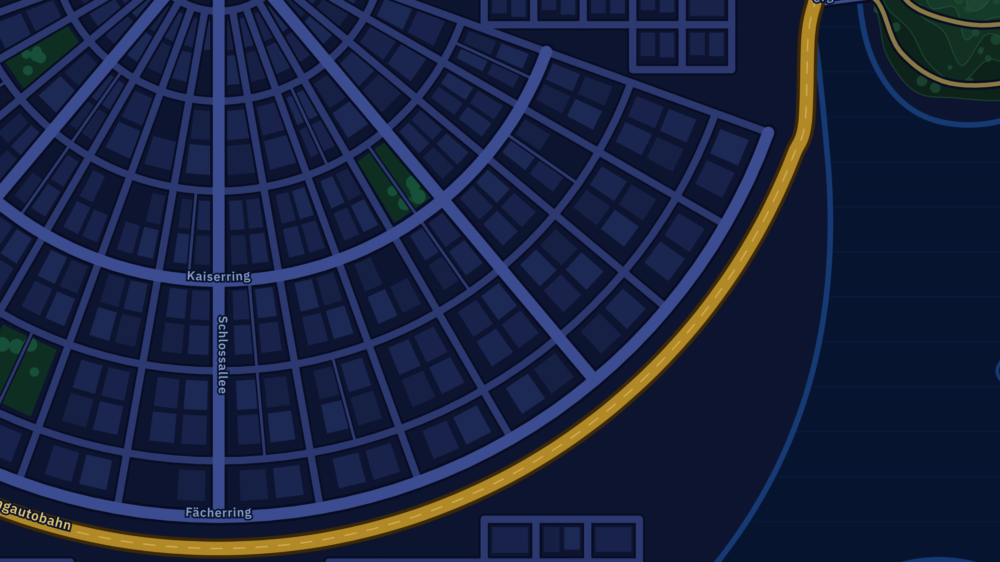

# Cockpit-Karten aus dem Trainingscenter

Diese Dateien kommen aus dem Trainingscenter (trainingscenter.streetsoflogic.de, Stand Quellen_11, 13.11.2026). Gezeichnet mit dem Kartencode des Trainingscenters, ohne Missions-Marker, Schilder und Stadtteil-Beschriftungen. Das Cockpit in Streets of Logic legt seine eigene Klassen-Ebene darüber.

## Dateien
- `index.json` – Liste aller Stadtteile (Klasse, id, Name, Anzahl Missionen, JSON-Datei)
- pro Stadtteil `k<klasse>-<id>.jpg` (2880 × 1620, 16:9) und `k<klasse>-<id>.json`

Enthalten: k9-potenzen, k9-quadratische-gleichungen, k9-pythagoras, k10-funktionen, k10-trigonometrie.

## JSON-Felder
- `viewBox` [x, y, w, h]: Koordinatensystem des Bildes. Ein SVG mit genau dieser viewBox, gleich groß über das Bild gelegt (beide 16:9), trifft jeden Punkt exakt.
- `missions`: n, name, wz (Was-Ziel-ID wie in Streets of Logic, z. B. qg-01), x, y
- `start`, `ziel` (mit `label`)
- `routeSegments`: SVG-Pfade. Stück 0 = Start → Mission 1, Stück i = Mission i → Mission i+1, letztes Stück = letzte Mission → Ziel.
- `routeColor`: Farbe des Stadtteils im Trainingscenter (für „gefahrene“ Strecke)

## Darüber zeichnen (wie im Trainingscenter)
```html
<div style="position:relative;aspect-ratio:16/9">
  
  <svg viewBox="605.6 230 888.9 500" style="position:absolute;inset:0;width:100%;height:100%">…</svg>
</div>
```
Missions-Marker wie im Trainingscenter: Kreis r = 15, drei Ringsegmente auf r = 21 mit den Winkeln Rookie 212°–328°, Operator 338°–452°, Street Legend 102°–202° (0° = rechts, im Uhrzeigersinn). Ring-Farben auf der Karte wie im Trainingscenter: Rookie #ffc300, Operator #f97316, Street Legend #ff2ea6.

## Neue Stadtteile
Wenn im Trainingscenter ein neuer Stadtteil befahrbar wird, im Trainingscenter-Chat neu exportieren lassen und die Dateien hier ergänzen.
